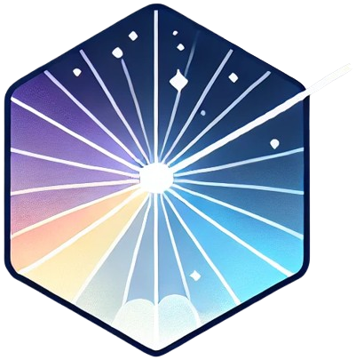

<!-- Improved compatibility of back to top link: See: https://github.com/othneildrew/Best-README-Template/pull/73 -->
<a id="readme-top"></a>

<!-- PROJECT SHIELDS -->
[![PyPI][pypi-shield]][pypi-url]
[![Contributors][contributors-shield]][contributors-url]
[![Forks][forks-shield]][forks-url]
[![Stargazers][stars-shield]][stars-url]
[![Issues][issues-shield]][issues-url]
[![MIT][license-shield]][license-url]

<!-- PROJECT LOGO -->
<br />
<div align="center">
  <a href="https://github.com/arunoruto/lumafit">
    
  </a>

<h3 align="center">lumafit</h3>

  <p align="center">
    A Numba-accelerated Levenberg-Marquardt fitting library for Python.
    <br />
    Optimized for pixel-wise fitting on 3D image data.
    <br />
    <a href="https://arunoruto.github.io/lumafit/"><strong>Explore the docs »</strong></a>
    <br />
    <br />
    <a href="https://github.com/arunoruto/lumafit/issues/new?labels=bug">Report Bug</a>
    &middot;
    <a href="https://github.com/arunoruto/lumafit/issues/new?labels=enhancement">Request Feature</a>
  </p>
</div>

<!-- TABLE OF CONTENTS -->
<details>
  <summary>Table of Contents</summary>
  <ol>
    <li>
      <a href="#about-the-project">About The Project</a>
      <ul>
        <li><a href="#built-with">Built With</a></li>
      </ul>
    </li>
    <li>
      <a href="#getting-started">Getting Started</a>
      <ul>
        <li><a href="#prerequisites">Prerequisites</a></li>
        <li><a href="#installation">Installation</a></li>
      </ul>
    </li>
    <li><a href="#usage">Usage</a></li>
    <li><a href="#performance">Performance</a></li>
    <li><a href="#development">Development</a></li>
    <li><a href="#roadmap">Roadmap</a></li>
    <li><a href="#contributing">Contributing</a></li>
    <li><a href="#license">License</a></li>
    <li><a href="#contact">Contact</a></li>
    <li><a href="#acknowledgments">Acknowledgments</a></li>
  </ol>
</details>

<!-- ABOUT THE PROJECT -->

## About The Project

![Time per fit for lumafit, SciPy and optimistix][benchmark-light]
![Time per fit for lumafit, SciPy and optimistix][benchmark-dark]

`lumafit` fits many small non-linear least squares problems at once, such as
one curve along the third dimension for every pixel of an image cube. Calling
`scipy.optimize.least_squares` in a Python loop spends most of its time in the
interpreter; `lumafit` implements the Levenberg-Marquardt algorithm in
[Numba](https://numba.pydata.org/), compiles it together with your model and
runs the fits on all cores.

- `levenberg_marquardt_core` fits a single curve.
- `levenberg_marquardt_pixelwise` fits every pixel of a
  `(rows, cols, samples)` cube in parallel and skips pixels masked with NaN.
- Weighted least squares, returning the covariance matrix of the parameters.
- Finite difference Jacobian by default, analytical Jacobian if you have one.
- The solver is a nopython function, so it can be called from your own
  Numba-compiled code.

<p align="right">(<a href="#readme-top">back to top</a>)</p>

### Built With

- [![Python][Python-shield]][Python-url]
- [![Numba][Numba-shield]][Numba-url]
- [![NumPy][NumPy-shield]][NumPy-url]
- [![SciPy][SciPy-shield]][SciPy-url]
- [![uv][uv-shield]][uv-url]
- [![Nix][Nix-shield]][Nix-url]

<p align="right">(<a href="#readme-top">back to top</a>)</p>

<!-- GETTING STARTED -->

## Getting Started

### Prerequisites

Python 3.10 or newer. NumPy, Numba and SciPy are installed as dependencies;
SciPy provides the BLAS/LAPACK routines Numba uses for linear algebra.

### Installation

From [PyPI][pypi-url]:

```sh
pip install lumafit
# or
uv add lumafit
```

From source:

```sh
git clone https://github.com/arunoruto/lumafit.git
cd lumafit
pip install .
```

<p align="right">(<a href="#readme-top">back to top</a>)</p>

<!-- USAGE EXAMPLES -->

## Usage

The model is called as `func(p, *args)` and has to be a Numba nopython
function **defined with `*args`**. Whatever you pass as `args` to the solver
arrives there, typically the independent variable.

```python
import numpy as np
from numba import njit
from lumafit import levenberg_marquardt_core, levenberg_marquardt_pixelwise


@njit
def decay(p, *args):
    t = args[0]
    return p[0] * np.exp(-t / p[1]) + p[2] * np.exp(-t / p[3])


t = np.linspace(0.1, 25, 100)
p_true = np.array([5.0, 2.0, 2.0, 10.0])
p0 = np.array([4.0, 1.5, 1.5, 8.0])
rng = np.random.default_rng(0)
```

### Fitting a single curve

```python
y = decay(p_true, t) + rng.normal(0, 0.02, t.shape)

p_fit, cov, chi2, n_iter, converged = levenberg_marquardt_core(
    decay, p0, y, args=(t,)
)
```

### Fitting pixel-wise on 3D data

```python
cube = decay(p_true, t) + rng.normal(0, 0.02, (128, 128, t.size))
cube[0, 0, :] = np.nan  # masked pixels are skipped

p, cov, chi2, n_iter, converged = levenberg_marquardt_pixelwise(
    decay, p0, cube, args_for_each_pixel=(t,)
)

p.shape           # (128, 128, 4)
converged.mean()  # fraction of pixels that converged
```

The first call compiles the solver for your model, which takes around ten
seconds; after that the 16,384 fits above run in about 0.15 s on 16 threads.

Weights (`1 / sigma**2`), an analytical Jacobian (`jac_func`) and minimizing a
residual function directly are covered in the
[Documentation](https://arunoruto.github.io/lumafit/usage.html).

<p align="right">(<a href="#readme-top">back to top</a>)</p>

<!-- PERFORMANCE -->

## Performance

Time per fit for a 128 × 128 cube with 100 samples per pixel and 4 parameters,
on an Intel Core i9-9900K (8 cores, 16 threads):

| Solver                                    | Exponential decay | Polarization curve |
| ----------------------------------------- | ----------------: | -----------------: |
| `scipy.optimize.least_squares`, loop      |            853 µs |             993 µs |
| `optimistix.LevenbergMarquardt` + `vmap`  |            205 µs |             451 µs |
| lumafit 0.2.3, 16 threads                 |           15.4 µs |            32.3 µs |
| **lumafit, 1 thread**                     |           50.4 µs |             158 µs |
| **lumafit, 16 threads**                   |            8.4 µs |            21.5 µs |
| **lumafit, 16 threads, analytic Jacobian** |            6.8 µs |                  – |

All solvers find the same minimum (fitted parameters agree to 1e-7 or better).
The one-off compilation of about ten seconds per model is not included, so for a
few hundred curves SciPy is still the quicker choice. Methodology and the full
table are in the
[benchmark docs](https://arunoruto.github.io/lumafit/benchmarks.html); to
reproduce:

```sh
uv run --group bench python benchmarks/run.py
uv run --group bench python benchmarks/report.py
```

<p align="right">(<a href="#readme-top">back to top</a>)</p>

<!-- DEVELOPMENT -->

## Development

The project is managed with [uv](https://docs.astral.sh/uv/):

```sh
uv sync --group test --group docs
uv run pytest                                              # tests and doctests
uv run sphinx-build -M html docs/source docs/build -W      # documentation
```

The tests check the solver against known solutions and against
`scipy.optimize.least_squares`.

On Nix, the flake provides the same environment (loaded automatically with
direnv):

```sh
nix develop .#uv2nix
```

<p align="right">(<a href="#readme-top">back to top</a>)</p>

<!-- ROADMAP -->

## Roadmap

- [x] Support analytical Jacobian functions.
- [x] Nielsen's damping strategy.
- [x] Documentation and examples.
- [x] Publish on PyPI.
- [ ] Implement parameter bounds.
- [ ] Improve robustness for ill-conditioned problems.

See the [open issues](https://github.com/arunoruto/lumafit/issues) for a full list of proposed features (and known issues).

<p align="right">(<a href="#readme-top">back to top</a>)</p>

<!-- CONTRIBUTING -->

## Contributing

Contributions are welcome! If you have suggestions or find bugs, please open an issue or submit a pull request.

1. Fork the Project
2. Create your Feature Branch (`git checkout -b feature/AmazingFeature`)
3. Commit your Changes (`git commit -m 'feat: add some AmazingFeature'`)
4. Push to the Branch (`git push origin feature/AmazingFeature`)
5. Open a Pull Request

Releases are cut with
[python-semantic-release](https://python-semantic-release.readthedocs.io/), so
commit messages follow [Conventional Commits](https://www.conventionalcommits.org/).

<p align="right">(<a href="#readme-top">back to top</a>)</p>

<!-- LICENSE -->

## License

Distributed under the [MIT License][license-url]. See `LICENSE` for more information.

<p align="right">(<a href="#readme-top">back to top</a>)</p>

<!-- CONTACT -->

## Contact

Mirza Arnaut - mirza.arnaut@tu-dortmund.de

Project Link: [https://github.com/arunoruto/lumafit](https://github.com/arunoruto/lumafit)

<p align="right">(<a href="#readme-top">back to top</a>)</p>

<!-- ACKNOWLEDGMENTS -->

## Acknowledgments

- Levenberg (1944) and Marquardt (1963) for the algorithm, Nielsen (1999) for
  the damping update and Gavin (2020) for a very readable description; full
  [references](https://arunoruto.github.io/lumafit/references.html) are in the docs.
- [Numba](https://numba.pydata.org/) for providing the acceleration capabilities.
- [NumPy](https://numpy.org/) and [SciPy](https://scipy.org/) for fundamental numerical computing tools.
- [pytest](https://docs.pytest.org/) for the testing framework.
- [othneildrew/Best-README-Template](https://github.com/othneildrew/Best-README-Template) for the README structure template.

<p align="right">(<a href="#readme-top">back to top</a>)</p>

<!-- MARKDOWN LINKS & IMAGES -->
<!-- https://www.markdownguide.org/basic-syntax/#reference-style-links -->

[benchmark-light]: docs/source/benchmarks/benchmark-light.svg#gh-light-mode-only
[benchmark-dark]: docs/source/benchmarks/benchmark-dark.svg#gh-dark-mode-only
[pypi-shield]: https://img.shields.io/pypi/v/lumafit.svg?style=for-the-badge
[pypi-url]: https://pypi.org/project/lumafit/
[contributors-shield]: https://img.shields.io/github/contributors/arunoruto/lumafit.svg?style=for-the-badge
[contributors-url]: https://github.com/arunoruto/lumafit/graphs/contributors
[forks-shield]: https://img.shields.io/github/forks/arunoruto/lumafit.svg?style=for-the-badge
[forks-url]: https://github.com/arunoruto/lumafit/network/members
[stars-shield]: https://img.shields.io/github/stars/arunoruto/lumafit.svg?style=for-the-badge
[stars-url]: https://github.com/arunoruto/lumafit/stargazers
[issues-shield]: https://img.shields.io/github/issues/arunoruto/lumafit.svg?style=for-the-badge
[issues-url]: https://github.com/arunoruto/lumafit/issues
[license-shield]: https://img.shields.io/github/license/arunoruto/lumafit.svg?style=for-the-badge
[license-url]: https://github.com/arunoruto/lumafit/blob/main/LICENSE
[Python-shield]: https://img.shields.io/badge/Python-3776AB?style=for-the-badge&logo=python&logoColor=white
[Python-url]: https://www.python.org/
[Numba-shield]: https://img.shields.io/badge/Numba-00A3E0?style=for-the-badge&logo=numba&logoColor=white
[Numba-url]: https://numba.pydata.org/
[NumPy-shield]: https://img.shields.io/badge/NumPy-013243?style=for-the-badge&logo=numpy&logoColor=white
[NumPy-url]: https://numpy.org/
[SciPy-shield]: https://img.shields.io/badge/SciPy-8CAAE6?style=for-the-badge&logo=scipy&logoColor=white
[SciPy-url]: https://scipy.org/
[uv-shield]: https://img.shields.io/badge/uv-DE5FE9?style=for-the-badge&logo=uv&logoColor=white
[uv-url]: https://docs.astral.sh/uv/
[Nix-shield]: https://img.shields.io/badge/Nix-5277C3?style=for-the-badge&logo=nixos&logoColor=white
[Nix-url]: https://nixos.org/
